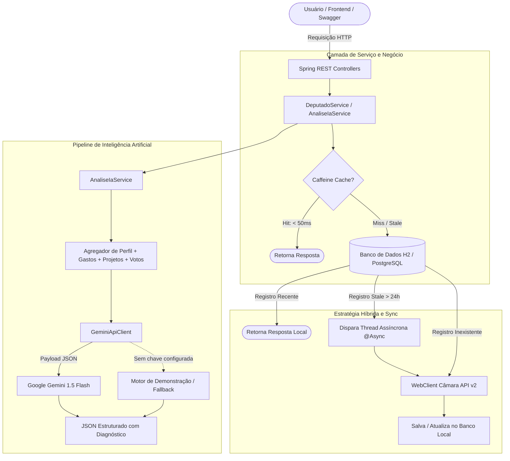

# 🇧🇷 Voto Consciente IA — Plataforma de Auditoria e Inteligência Parlamentar

[](https://openjdk.org/)
[](https://spring.io/projects/spring-boot)
[](https://aistudio.google.com/)
[](https://opensource.org/licenses/MIT)
[](http://localhost:8080/swagger-ui.html)

API RESTful de alta disponibilidade construída em **Java 21** e **Spring Boot** para consumir, auditar e cruzar dados públicos oficiais da **Câmara dos Deputados**. O sistema integra um módulo de **Inteligência Artificial (Google Gemini)** para gerar relatórios apartidários e objetivos sobre o perfil, coerência de votos e padrão de gastos dos parlamentares brasileiros.

---

## 📌 Sumário
- [Problema que o Projeto Resolve](#-problema-que-o-projeto-resolve)
- [Arquitetura e Fluxo de Dados](#-arquitetura-e-fluxo-de-dados)
- [Diferenciais de Engenharia de Software](#-diferenciais-de-engenharia-de-software)
- [Endpoints da API](#-endpoints-da-api)
- [Como Obter a Chave Gratuita da API do Gemini](#-como-obter-a-chave-gratuita-da-api-do-gemini)
- [Como Executar o Projeto](#-como-executar-o-projeto)
- [Estrutura de Pacotes](#-estrutura-de-pacotes)
- [Tecnologias Utilizadas](#-tecnologias-utilizadas)

---

## 🎯 Problema que o Projeto Resolve

Dados governamentais no Brasil são públicos por força da Lei de Acesso à Informação (LAI), mas apresentam barreiras técnicas severas para o cidadão comum:
1. **Dispersão e Complexidade:** Votações nominais, notas fiscais da cota parlamentar (CEAP) e proposições de lei ficam em telas e formatos desarticulados.
2. **Lentidão e Rate Limiting:** Consultas diretas a APIs públicas enfrentam picos de latência e indisponibilidade.
3. **Linguagem Hermética:** Termos regimentais ("Subemenda Substitutiva", "Parecer de Mérito", "Obstrução") dificultam o entendimento do eleitor.

O **Voto Consciente IA** atua como uma camada inteligente entre os dados brutos e o cidadão, normalizando as informações, aplicando cache resiliente e traduzindo os fatos legislativos em diagnósticos claros via IA.

---

## 🏗️ Arquitetura e Fluxo de Dados

A aplicação combina **Persistência Relacional**, **Cache em Dois Níveis** e **Processamento Assíncrono**:



---

## 💡 Diferenciais de Engenharia de Software

* **Estratégia Híbrida com Staleness Check:** As consultas priorizam o banco local e a memória; quando um registro ultrapassa o TTL de 24 horas, os dados existentes são retornados imediatamente ao usuário sem latência, enquanto uma thread assíncrona (`@Async`) sincroniza os dados frescos da Câmara.
* **Pipeline de Ingestão Agendada (CRON):** Rotina noturna com `@Scheduled(cron = "0 0 0 * * *")` que pagina e sincroniza automaticamente a bancada completa dos 513 deputados federais.
* **Tabela de Auditoria (`SyncLog`):** Rastreabilidade total de cada ciclo de sincronização com carimbo de data/hora, quantidade de registros importados e eventuais mensagens de falha de rede.
* **Cliente Reativo Não-Bloqueante (WebClient + Netty):** Configuração com timeouts rigorosos (`ReadTimeoutHandler`, `WriteTimeoutHandler`) e limite de buffer em memória expandido para **16MB**, evitando estouro de heap com grandes respostas JSON da Câmara.
* **Cache em Memória com Caffeine:** Caches nomeados com políticas de expiração sob medida (`deputados`: 60m, `votacoes`: 120m, `despesas`: 120m, `analise-ia`: 120m).
* **Engenharia de Prompt Apartidária com Structured Outputs:** Prompt blindado contra viés político, exigindo estritamente saída em JSON validado via schema.
* **Modo Demonstração (Zero-Friction Fallback):** O projeto roda e responde análises imediatamente mesmo que o desenvolvedor ainda não tenha inserido sua chave de API da IA.

---

## 🚀 Endpoints da API

A documentação interativa com Swagger UI pode ser acessada em:  
👉 **`http://localhost:8080/swagger-ui.html`**

### 1. Deputados Federais
| Método | Rota | Descrição |
|---|---|---|
| `GET` | `/api/v1/deputados` | Lista deputados (suporta filtros: `?uf=SP&partido=PL`) |
| `GET` | `/api/v1/deputados/buscar` | Busca por nome civil ou eleitoral (`?nome=Tabata`) |
| `GET` | `/api/v1/deputados/{camaraId}` | Perfil detalhado, foto, contatos e gabinete |
| `GET` | `/api/v1/deputados/{camaraId}/despesas` | Despesas da Cota Parlamentar CEAP (`?ano=2024&mes=5`) |
| `GET` | `/api/v1/deputados/{camaraId}/proposicoes` | Projetos de lei e proposições de sua autoria |
| `GET` | `/api/v1/deputados/{camaraId}/votacoes` | Histórico de posicionamentos em votações nominais |

### 2. Inteligência Artificial
| Método | Rota | Descrição |
|---|---|---|
| `GET` | `/api/v1/deputados/{camaraId}/analise-ia` | **Gera o relatório analítico de IA cruzando perfil, gastos e leis** |

#### Exemplo de Resposta do Endpoint de IA (`/analise-ia`):
```json
{
  "camaraId": 204379,
  "nome": "Acácio Favacho",
  "partido": "MDB",
  "uf": "AP",
  "resumoPerfil": "O parlamentar atua com ênfase na defesa dos interesses do estado do Amapá, concentrando esforços na captação de recursos para infraestrutura e serviços básicos...",
  "principaisBandeiras": [
    "Desenvolvimento Regional e Infraestrutura Amazônica",
    "Saúde Pública e Atenção Básica",
    "Gestão e Reforma Administrativa"
  ],
  "analiseGastos": "O parlamentar concentra os maiores volumes da cota parlamentar em serviços de divulgação de atividade parlamentar e passagens aéreas regulares...",
  "coerenciaAtuacao": "Observa-se alinhamento substantivo entre os projetos apresentados e as votações de bancada...",
  "pontosFortes": [
    "Regularidade de presença nas votações do Plenário",
    "Foco legislativo aderente às necessidades da região Norte"
  ],
  "pontosAtencao": [
    "Acompanhar a tramitação final dos projetos arquivados nas comissões"
  ],
  "scoreAtividade": 84,
  "dataAnalise": "15/11/2026 21:40:00",
  "modeloUtilizado": "gemini-1.5-flash",
  "modoDemonstracao": false,
  "notaMetodologia": "Análise processada em tempo real pelo modelo Google Gemini via cruzamento de dados oficiais da Câmara dos Deputados."
}
```

### 3. Painel Administrativo de Sincronização
| Método | Rota | Descrição |
|---|---|---|
| `POST` | `/api/v1/admin/sync/camara` | Dispara sincronização completa imediata da Câmara |
| `GET` | `/api/v1/admin/sync/status` | Histórico dos últimos 20 ciclos de sincronização |
| `GET` | `/api/v1/admin/sync/health` | Health-check das integrações externas |

---

## 🔑 Como Obter a Chave Gratuita da API do Gemini

O projeto utiliza a API do **Google Gemini** através do **Google AI Studio**, que disponibiliza uma cota gratuita generosa para desenvolvedores (15 requisições por minuto sem custo e sem necessidade de cartão de crédito):

1. Acesse o portal do **[Google AI Studio](https://aistudio.google.com/)**.
2. Faça login com sua conta do Google.
3. No menu lateral, clique em **"Get API key"**.
4. Clique no botão **"Create API key"**.
5. Copie a chave gerada.

### Como configurar a chave no projeto:
Você tem duas opções práticas:

**Opção 1: Via Variável de Ambiente (Recomendado para produção/CI):**
```bash
# Windows PowerShell
$env:GEMINI_API_KEY="sua_chave_aqui"

# Linux / macOS
export GEMINI_API_KEY="sua_chave_aqui"
```

**Opção 2: No arquivo `application.yaml`:**
```yaml
gemini:
  api-key: "sua_chave_aqui"
  model: gemini-1.5-flash
```

> 💡 **Nota:** Se você não configurar a chave, o sistema automaticamente ativará o **Modo de Demonstração**, calculando as métricas e retornando relatórios estruturados sem gerar erro.

---

## 💻 Como Executar o Projeto

### Pré-requisitos
* **Java 21** instalado (`java -version`)
* **Git** instalado

### Passo a Passo

1. **Clone o repositório:**
   ```bash
   git clone https://github.com/SEU_USUARIO/voto-consciente-ia.git
   cd voto-consciente-ia/Voto-Consciente-IA
   ```

2. **Compile e baixe as dependências:**
   ```bash
   # Windows
   .\mvnw.cmd clean compile

   # Linux / macOS
   ./mvnw clean compile
   ```

3. **Inicie a aplicação:**
   ```bash
   # Windows
   .\mvnw.cmd spring-boot:run

   # Linux / macOS
   ./mvnw spring-boot:run
   ```

4. **Acesse a aplicação no navegador:**
   * **Swagger UI:** [http://localhost:8080/swagger-ui.html](http://localhost:8080/swagger-ui.html)
   * **Console do Banco H2:** [http://localhost:8080/h2-console](http://localhost:8080/h2-console)  
     *(JDBC URL: `jdbc:h2:mem:votoconsciente` | Usuário: `sa` | Senha: em branco)*

---

## 📂 Estrutura de Pacotes

```text
br.com.votoconsciente/
├── VotoConscienteApplication.java   # Ponto de entrada com @EnableCaching e @EnableScheduling
│
├── config/                          # Configurações de infraestrutura
│   ├── WebClientConfig.java         # Clientes HTTP reativos com Netty e buffer de 16MB
│   ├── CacheConfig.java             # Gestão de cache em memória com Caffeine
│   └── OpenApiConfig.java           # Metadados e documentação Swagger 3.0
│
├── camara/                          # Ingestão da API da Câmara dos Deputados
│   ├── client/CamaraApiClient.java  # Cliente HTTP com chamadas à API v2
│   ├── dto/                         # DTOs de mapeamento das respostas públicas
│   └── service/CamaraSyncService.java # Job noturno agendado e sync assíncrono
│
├── deputado/                        # Domínio de Deputados Federais
│   ├── entity/Deputado.java         # Entidade persistida com índices e staleness check
│   ├── dto/DeputadoResponseDTO.java # DTO de saída desacoplado do banco
│   ├── repository/DeputadoRepository.java # Consultas otimizadas por nome, UF e partido
│   ├── service/DeputadoService.java # Regras de negócio e cache híbrido
│   └── controller/DeputadoController.java # Endpoints REST de deputados
│
├── ia/                              # Módulo de Inteligência Artificial
│   ├── client/GeminiApiClient.java  # Cliente da API do Google Gemini + Fallback local
│   ├── dto/AnaliseIaResponseDTO.java # Relatório estruturado gerado pela IA
│   ├── service/AnaliseIaService.java # Agregador de contexto legislativo e chamada à LLM
│   └── controller/AnaliseIaController.java # Endpoint REST /analise-ia
│
└── sync/                            # Auditoria de Sincronizações
    ├── entity/SyncLog.java          # Registro de auditoria das execuções
    ├── repository/SyncLogRepository.java
    └── controller/SyncController.java # Endpoints de acionamento manual e health-check
```

---

## 🛠️ Tecnologias Utilizadas

* **Linguagem:** Java 21 (LTS)
* **Framework:** Spring Boot 3.4+
* **Comunicação Reativa:** Spring WebFlux (`WebClient`) com Reactor Netty
* **Persistência de Dados:** Spring Data JPA / Hibernate
* **Bancos de Dados:** H2 Database (desenvolvimento em memória) e PostgreSQL (produção)
* **Cache em Memória:** Caffeine Cache Manager
* **Inteligência Artificial:** Google Gemini (1.5 Flash / 2.0 Flash via Google AI Studio)
* **Documentação de API:** SpringDoc OpenAPI 3.0 / Swagger UI
* **Produtividade:** Lombok

---

## 📄 Licença
Distribuído sob a licença **MIT**. Veja `LICENSE` para mais informações.
